---

copyright:
  years: 2026
lastupdated: "2026-10-26"

keywords:

subcollection: db2-saas

---

{:external: target="_blank" .external}
{:shortdesc: .shortdesc}
{:codeblock: .codeblock}
{:screen: .screen}
{:tip: .tip}
{:important: .important}
{:note: .note}
{:deprecated: .deprecated}
{:pre: .pre}

# Upgrading to Db2 version 12
{: #db2-upgrade}

You can upgrade your database from Db2 version 11.5 to Db2 version 12 from the console. Upgrading gives you access to new Db2 capabilities and enhancements, performance and operational improvements that help streamline database management, and keeps your environment aligned with the latest supported Db2 release.
{: shortdesc}

The upgrade has two steps: a pre-upgrade check, followed by the upgrade itself. The upgrade option is enabled only after the most recent pre-upgrade check passes.

When the upgrade begins, your database goes offline. After the upgrade completes, it cannot be rolled back.
{: important}

## Before you begin
{: #db2-upgrade-prereqs}

To prepare for the upgrade, it is highly recommended that you:

1. Take a snapshot backup right before upgrading as a safeguard for faster recovery and reduced downtime.
1. Clone your version 11.5 instance and upgrade the clone to version 12 to gauge outage time.
1. Test your applications against the version 12 clone to confirm compatibility.
1. Delete the clone once validation is complete and you are ready to proceed.

## What to expect
{: #db2-upgrade-expect}

- Your data and database configurations are preserved.
- Your database experiences temporary downtime during the upgrade.
- A backup is created automatically after the upgrade completes.
- Estimated time for the pre-upgrade check: 2-5 minutes.
- Estimated time for the upgrade: 1-2 hours.

## Upgrading your database
{: #db2-upgrade-steps}

1. On the **Databases** page, locate the instance you want to upgrade. Instances on an older Db2 version show an **Upgrade** button in the **Action** column.
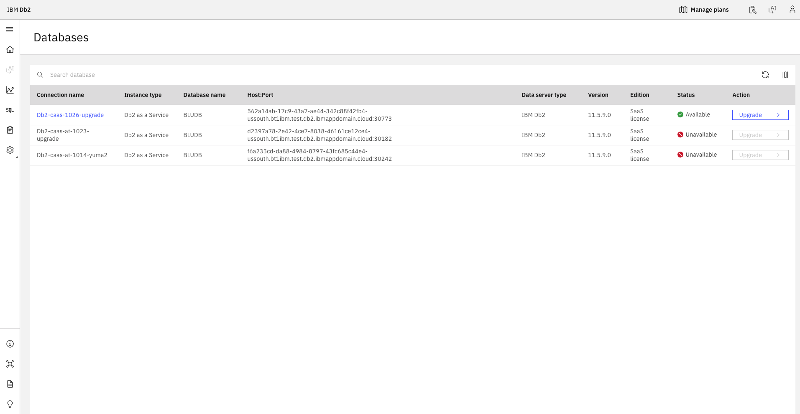{: caption="Instances on an older Db2 version show an Upgrade button in the Action column." caption-side="bottom"}

1. Click **Upgrade**, or click the instance name and select **Db2 upgrade** on the **Administration** page.
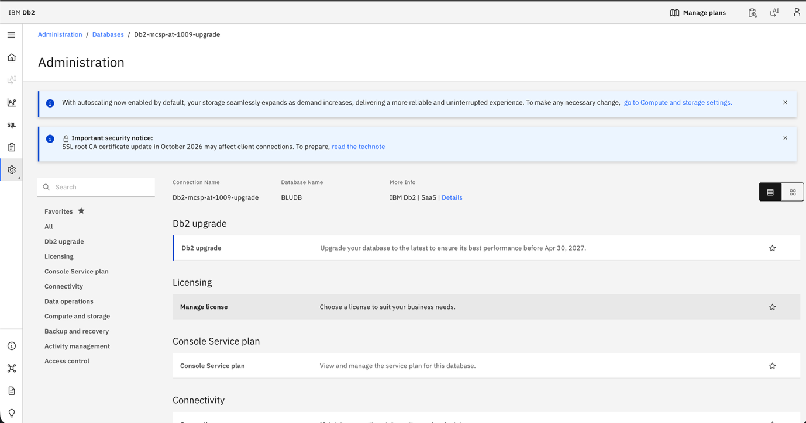{: caption="The Db2 upgrade tile on the Administration page." caption-side="bottom"}

1. The **Db2 Upgrade** page opens and shows the steps to upgrade to Db2 version 12. Only **Step 1 - Pre-upgrade check** is available. **Upgrade to version 12** stays disabled until the pre-upgrade check passes.
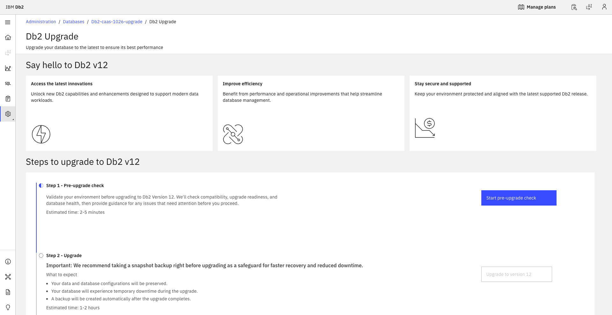{: caption="The Db2 Upgrade page before the pre-upgrade check is run." caption-side="bottom"}

1. Click **Start pre-upgrade check**. The check validates compatibility, upgrade readiness, and database health, then provides guidance for any issues that need attention before you proceed.
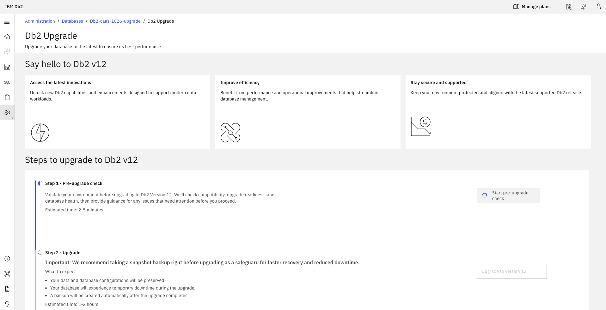{: caption="The pre-upgrade check in progress." caption-side="bottom"}

1. When the check passes, the page shows **All readiness checks passed. Ready to upgrade.** with the time of the last run, and **Upgrade to version 12** is enabled.
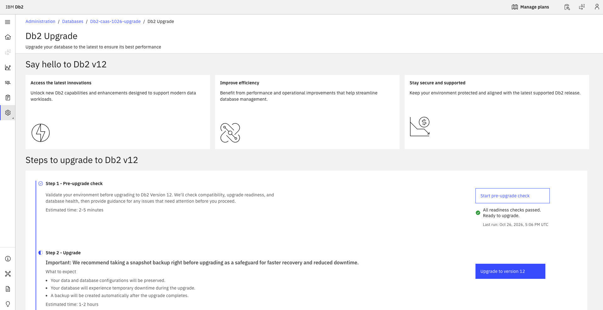{: caption="The pre-upgrade check passed and Upgrade to version 12 is enabled." caption-side="bottom"}

   You can run the pre-upgrade check as many times as needed. **Upgrade to version 12** is enabled only when the most recent check passes.
   {: note}

1. Click **Upgrade to version 12**. A confirmation dialog shows important notes and the recommended preparation steps. Click **Upgrade now** to start the upgrade.
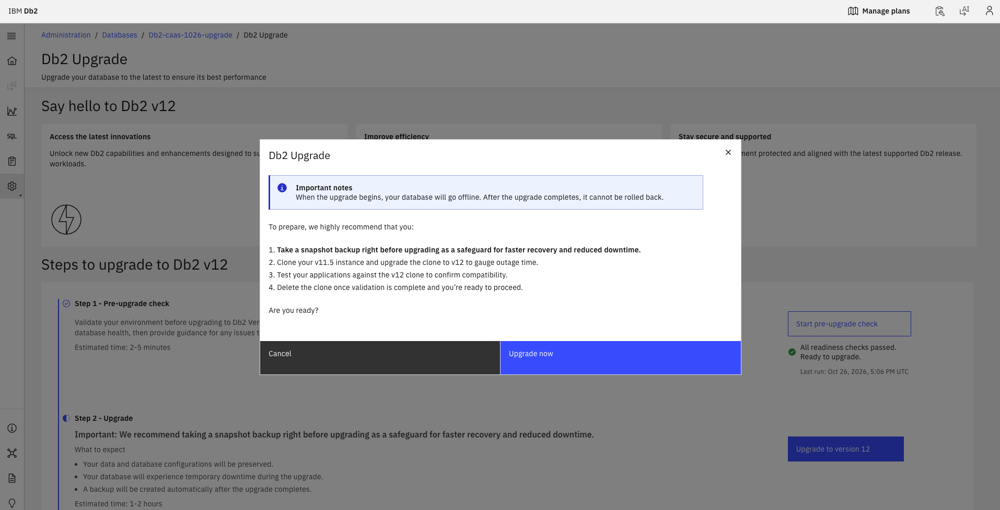{: caption="The Db2 Upgrade confirmation dialog." caption-side="bottom"}

1. The upgrade starts. The current upgrade state is shown below **Upgrade to version 12**, for example **Upgrading database.**
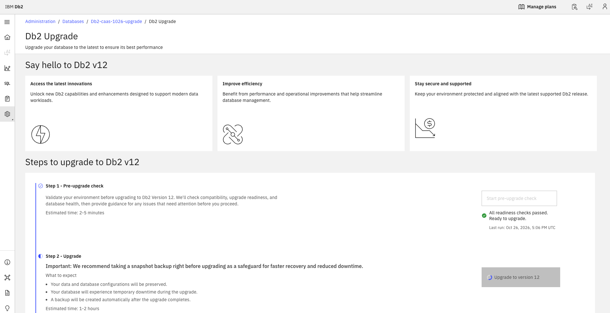{: caption="The upgrade started." caption-side="bottom"}
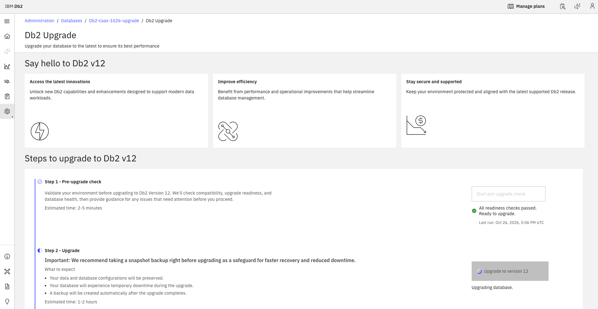{: caption="The upgrade in progress." caption-side="bottom"}

1. When the upgrade finishes, the page shows **Upgrade successful. Database is available to use. We're running post-upgrade in the background.** with the time of the last run.
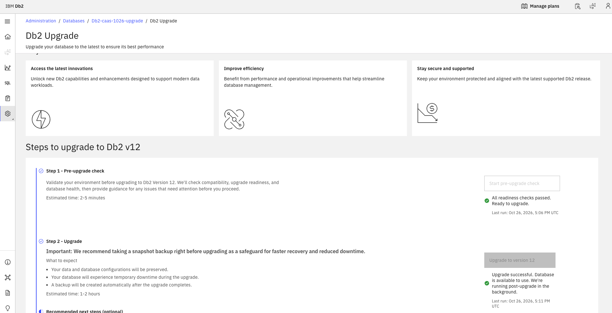{: caption="The upgrade completed successfully and post-upgrade is running in the background." caption-side="bottom"}

1. When post-upgrade finishes, the page shows **Upgrade complete.**
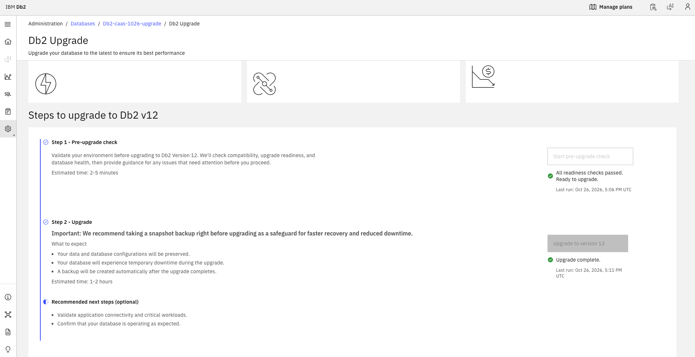{: caption="The upgrade is complete." caption-side="bottom"}

## During the upgrade
{: #db2-upgrade-during}

While the upgrade runs, your database is down and no other actions can be performed on it.

- On the **Databases** page, the instance status shows **Db upgrade in progress** and the **Upgrade** button is disabled. Clicking the instance name opens only the **Db2 Upgrade** page.
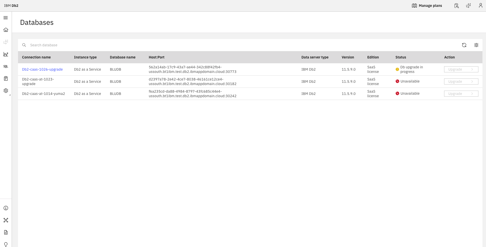{: caption="Instance status on the Databases page during the upgrade." caption-side="bottom"}

- Database users are redirected to an **Upgrade in progress** page and cannot perform any actions during the upgrade.
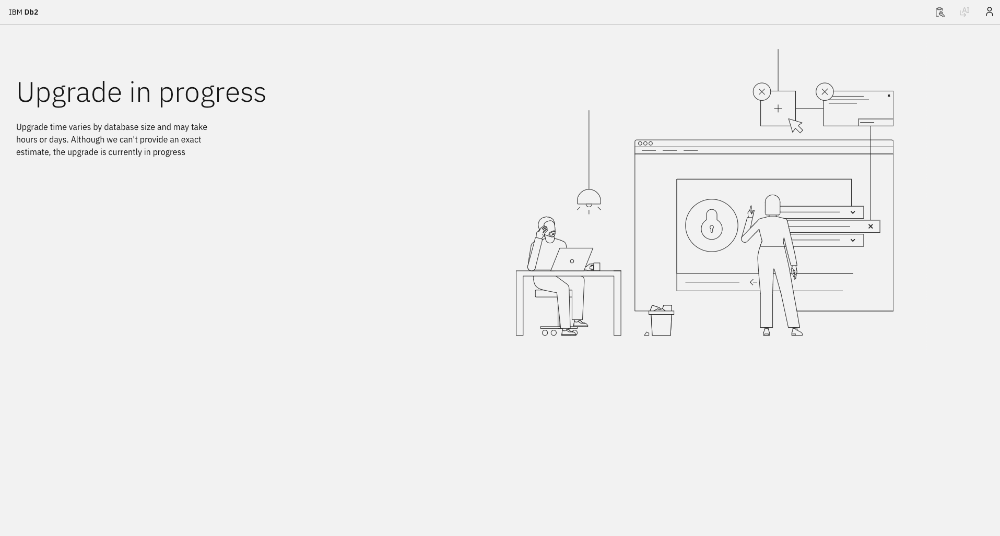{: caption="The page shown to database users during the upgrade." caption-side="bottom"}

## After the upgrade
{: #db2-upgrade-after}

- The **Databases** page shows the updated Db2 version for the instance.
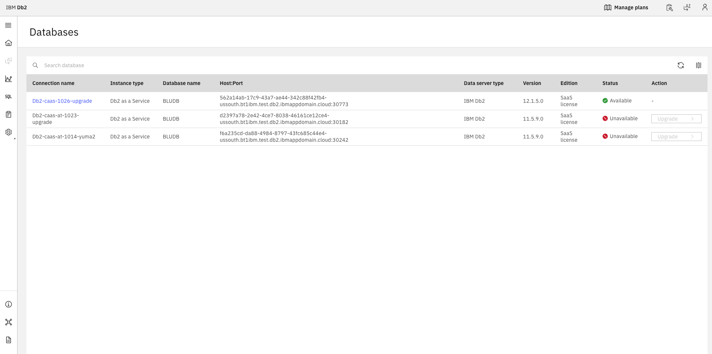{: caption="The updated Db2 version on the Databases page." caption-side="bottom"}

- The **Administration** page shows the banner **Your last database upgrade was successful.**
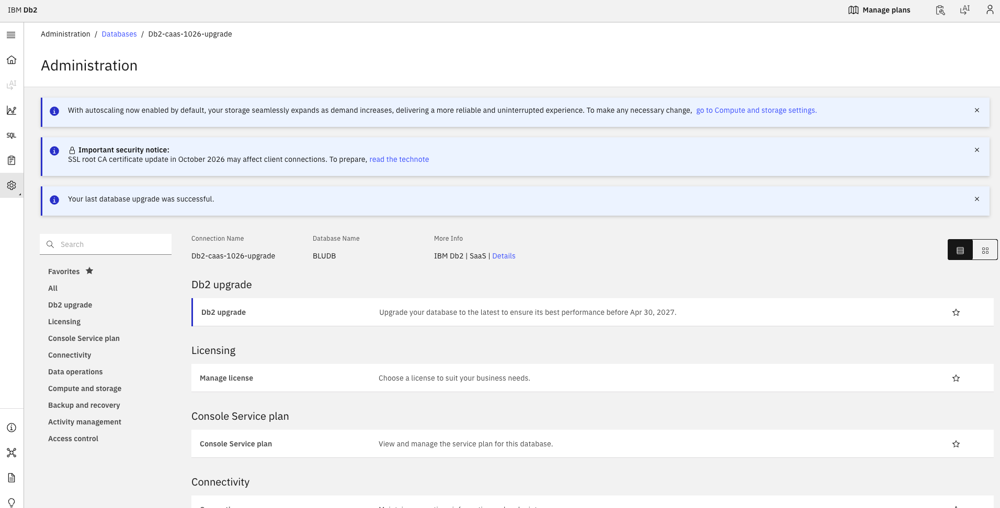{: caption="The upgrade success banner on the Administration page." caption-side="bottom"}

### Recommended next steps
{: #db2-upgrade-next-steps}

The following steps are optional:

- Validate application connectivity and critical workloads.
- Confirm that your database is operating as expected.
